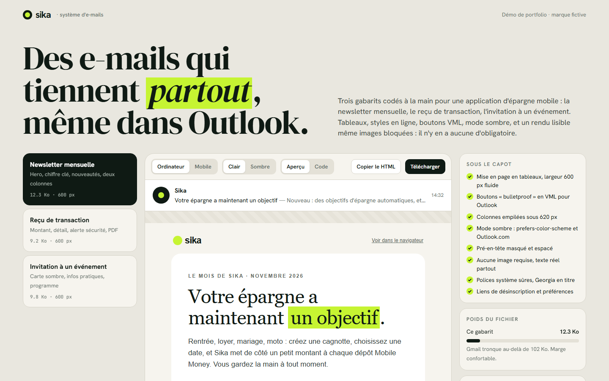
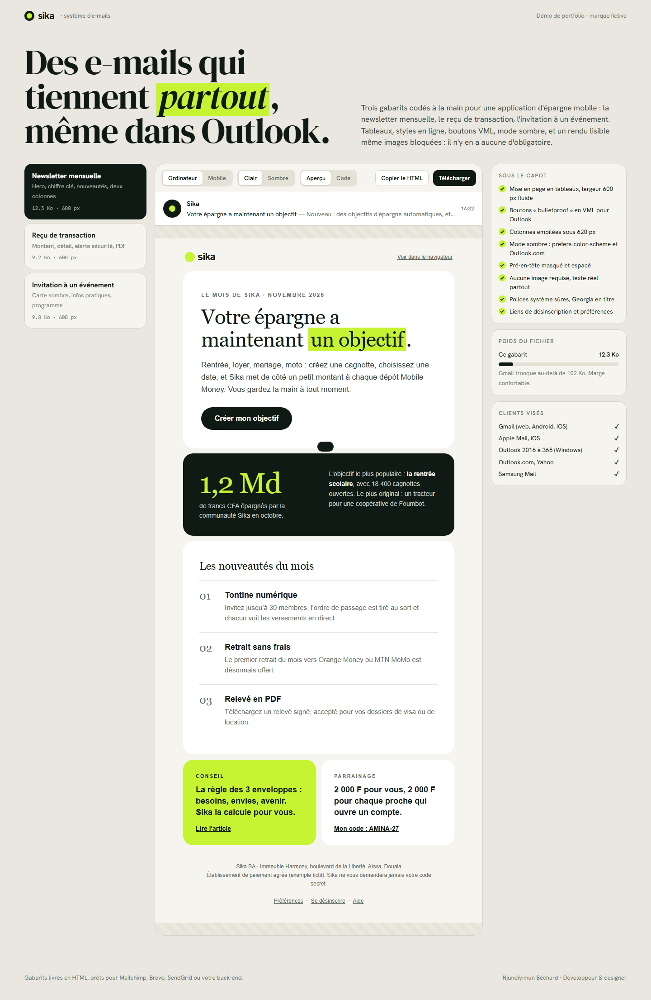
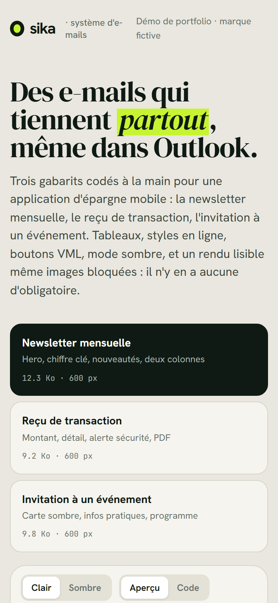

# Sika, système d'e-mails

**Gabarits e-mail responsives (newsletter, transactionnel, invitation)** — Trois gabarits e-mail codés à la main pour une application d'épargne mobile, générés depuis un même squelette Python, avec une page de présentation qui montre le rendu ordinateur, mobile, clair, sombre et le code source.

**Démo en ligne : [https://lordlennyx.github.io/sika-emails/](https://lordlennyx.github.io/sika-emails/)**

Spot de présentation (30 s) : [media/spot-30s.mp4](https://lordlennyx.github.io/sika-emails/media/spot-30s.mp4)

## Ce que le projet montre

- Newsletter mensuelle, reçu de transaction Mobile Money, invitation à un événement
- Mise en page en tableaux 600 px fluide, colonnes empilées sur mobile, styles en ligne
- Boutons « bulletproof » VML pour Outlook Windows, conditionnels MSO, réglage 96 DPI
- Mode sombre (prefers-color-scheme et Outlook.com), pré-en-tête masqué, aucune image obligatoire
- Poids entre 9 et 13 Ko, loin de la limite de troncature de Gmail (102 Ko)
- Studio de prévisualisation : boîte de réception simulée, bascules mobile / sombre / code, copie et téléchargement

## Réalisation

- **Stack :** HTML e-mail, CSS en ligne, VML, Python (générateur), JavaScript (studio)
- **Fichiers :** emails/newsletter.html, emails/recu-transaction.html, emails/invitation.html, src/build.py
- **Compatible avec :** Mailchimp, Brevo, SendGrid, Mailjet, envoi depuis un back-end

| Bureau | Mobile |
|---|---|
|  |  |

---

Client et contenus fictifs, créés pour la démonstration. Conception, design et développement : **Njundiyimun Béchard** — [github.com/LordLennyx](https://github.com/LordLennyx)
